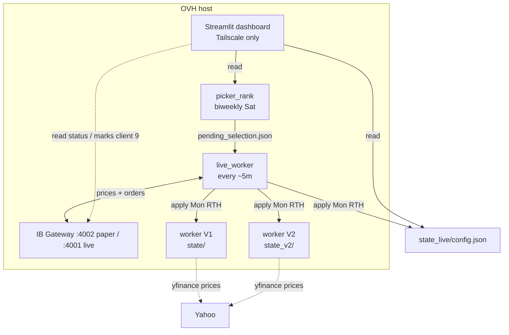
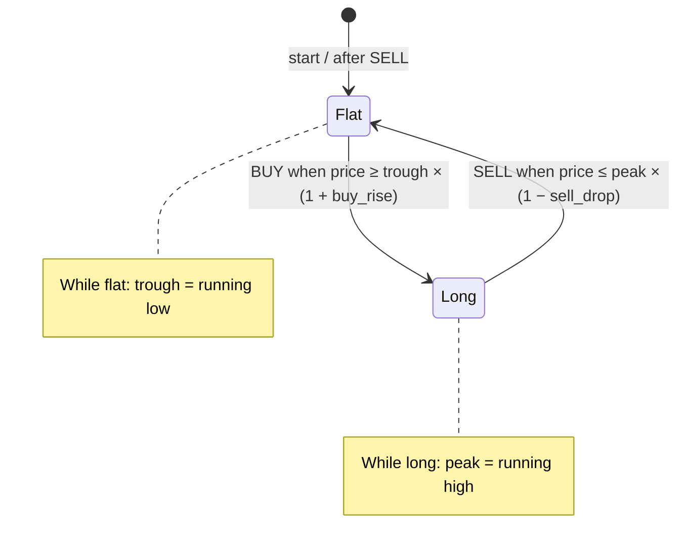
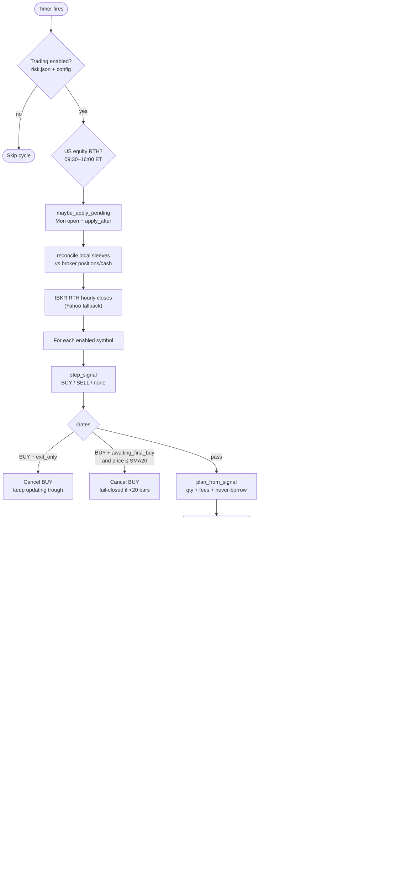
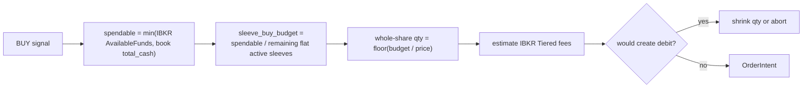
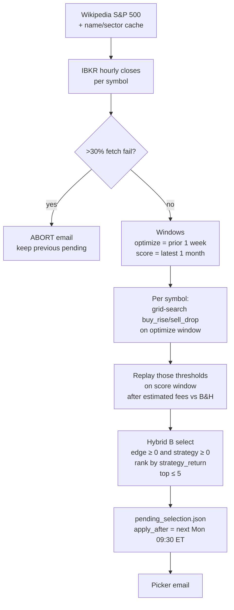
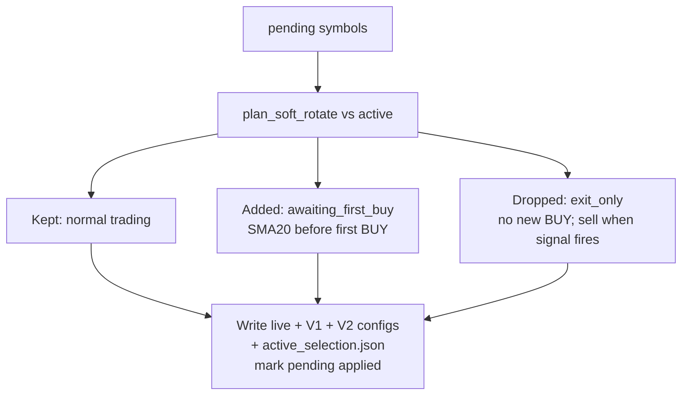
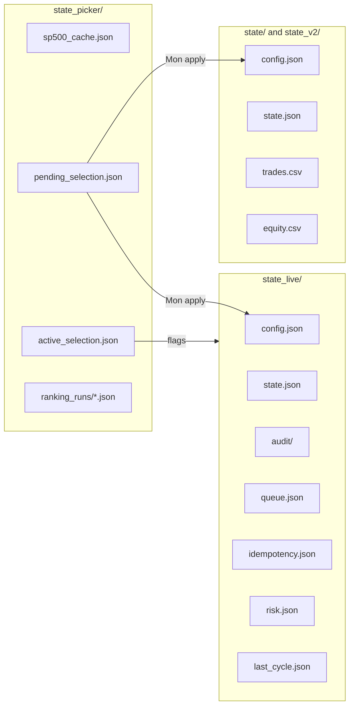
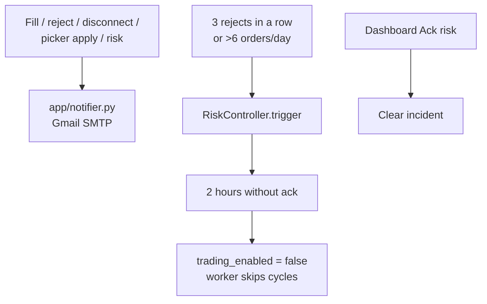
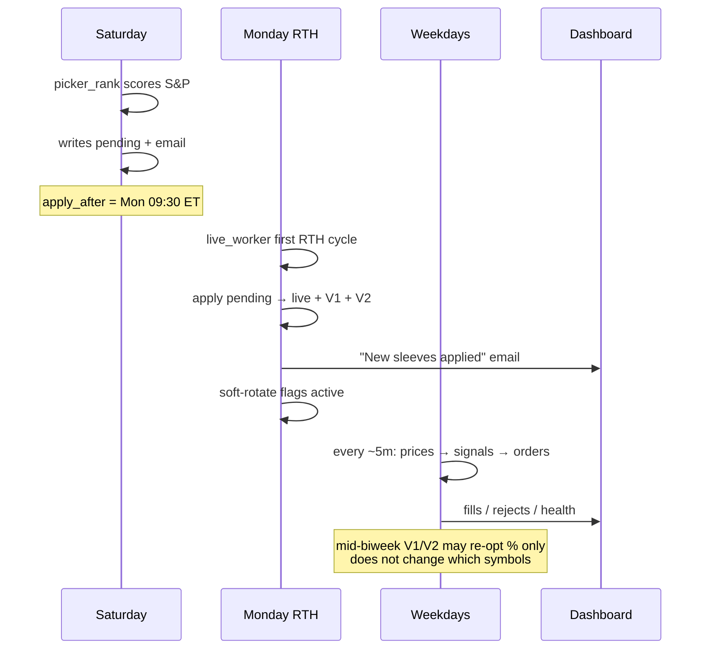

# How the bot works

A map of the whole system: what runs where, how a trade decision is made, and how the S&P picker feeds sleeves into live + paper.

**Audience:** you (operator), not an implementer checklist.  
**Code truth:** `app/` on OVH under `/opt/autonomous-trade-alerts`.  
**Companion docs:** investigation (decisions), blueprint (build prompts), todo (ops checklist).

---

## 1. Big picture

Three kinds of processes share one OVH host and one IB Gateway:

| Process | How often | Job |
|---------|-----------|-----|
| **Live worker** | ~every 5 min (`live-worker.timer`) | Prices → signals → (maybe) IBKR orders for the live book |
| **Paper V1 / V2 workers** | ~every 10 min (legacy / GHA or host cron) | Same peak/trough idea in **file-sim** books; alerts only, no IBKR orders |
| **Picker rank** | Biweekly Sat (`picker-rank.timer`) | Score S&P names → write `pending_selection.json` for Monday |
| **Dashboard** | Always on (`streamlit-dashboard.service`) | Tailscale viewer + safe controls (enable/disable/ack) |

**Mental model:** the **strategy** decides *when* to buy/sell a symbol. The **picker** decides *which* symbols get a sleeve. The **live worker** is the only path that can hit IBKR.

---

## 2. The core trading idea (peak / trough)

Every sleeve (live or paper) tracks one symbol with cash **or** shares (all-in / all-out).

| Term | Meaning |
|------|---------|
| **trough** | Lowest price seen while flat (cash) |
| **buy_rise** | How far price must bounce off the trough to BUY (e.g. 2% → `0.02`) |
| **peak** | Highest price seen while long (shares) |
| **sell_drop** | How far price must fall off the peak to SELL |

Implemented in `app/strategy.py` → `step_signal()`.

On each bar the strategy only answers: **BUY**, **SELL**, or **no signal**. It does **not** size the order or talk to the broker.

---

## 3. Live decision path (one cycle)

Entry: `python -m app.live_worker` → `run_live_once()` in `app/live_worker.py`.

### Per-symbol gates (live only)

| Gate | When | Effect |
|------|------|--------|
| **exit_only** | Symbol dropped by picker soft-rotate | Blocks new BUY; SELL still allowed |
| **SMA20 first buy** | Symbol newly added (`awaiting_first_buy`) | BUY only if last price **>** 20-hour SMA; fail closed if not enough bars |
| **Never-borrow** | Planning a BUY | Qty reduced / rejected if notional + fees > `AvailableFunds` (BuyingPower ignored) |
| **Whole shares** | IBKR US stocks | `allow_fractional_default=false`; qty floored to integers |
| **Idempotency** | Same symbol + bar timestamp + side | At most one live attempt |
| **RTH** | Outside regular session | Intent goes to `queue.json`, not the broker |

### Modes (`state_live/config.json` → `TradingMode`)

| Mode | Places IBKR orders? |
|------|---------------------|
| `sim` | No |
| `live_dry_run` | No (audit only) |
| `broker_paper` | Yes → paper Gateway **4002** |
| `live` | Yes → live Gateway **4001**, only if `LIVE_TRADING_CONFIRM=YES` |

Guard: `app/broker/gateway.py` (`BrokerGateway`).

---

## 4. How a BUY quantity is chosen

There is **no forced Monday rebalance**. Existing longs stay until a SELL signal; new names buy only when their BUY fires and cash is free.

---

## 5. S&P picker — choosing sleeves

Entry: `python -m app.picker_rank` → `run_ranking()` in `app/picker/run.py`.

### Pipeline

| Metric | Meaning |
|--------|---------|
| **strategy_return** | After-fee peak/trough P&amp;L on the score window |
| **bh_return** | After-fee buy-and-hold on the same window |
| **edge** | `strategy_return − bh_return` (must be ≥ 0 to qualify) |

Select logic: `app/picker/rank.py` → `select_symbols()`.

### Monday apply (soft rotate)

When `live_worker` sees RTH **and** `now ≥ apply_after`:

Files: `app/picker/apply.py`, `soft_rotate.py`, `apply_live.py`, `apply_paper.py`.

---

## 6. Paper V1 vs V2 (brief)

Both use the same peak/trough `step_signal`. Differences:

| | **V1** (`state/`) | **V2** (`state_v2/`) |
|--|-------------------|----------------------|
| Optimizer | Unconstrained grid on trailing window | Constrained grid + trip penalty (`meta_optimizer` / `optimize_params_v2`) |
| Broker | None — file cash/shares only | Same |
| Picker | Soft-rotate flags honored in `worker.py` | Same |
| Purpose | Baseline paper experiment | Constrained / fee-aware paper experiment |

Live is **not** a copy of V2: it adds IBKR, fees at order time, never-borrow, RTH, idempotency, and picker gates.

---

## 7. State map (what lives where)

| Path | Role |
|------|------|
| `state_live/config.json` | Mode, symbols, buy/sell %, `total_cash`, alerts |
| `state_live/state.json` | Per-symbol cash/shares/peak/trough; orders_today; reject_streak |
| `state_live/risk.json` | `trading_enabled` + open incident |
| `state_picker/pending_selection.json` | Weekend slate waiting for Monday |
| `state_picker/active_selection.json` | Soft-rotate flags after apply |

---

## 8. Risk and alerts

Disconnect emails are cooldown-suppressed (~6h) so Gateway flaps do not spam.

---

## 9. Invariants (do not break these)

1. **Whole shares** on IBKR — no fractional API orders.  
2. **Never borrow** — buys sized to `AvailableFunds`, not BuyingPower.  
3. **All-in / all-out per sleeve** — not partial target weights.  
4. **No forced Monday rebalance** — picker soft-rotates; sells wait for signals.  
5. **Picker abort** if &gt;30% IBKR bar fetches fail — previous pending kept.  
6. **Hybrid B** — sleeve must beat B&amp;H **and** make money; ranked by strategy profit.  
7. **Live money** only after G3 graduation + explicit `LIVE_TRADING_CONFIRM=YES`.

---

## 10. Typical week (ops story)

---

## 11. Where to read next in code

| Question | Start here |
|----------|------------|
| When do we BUY/SELL? | `app/strategy.py` → `step_signal` |
| Live cycle orchestration | `app/live_worker.py` → `run_live_once` |
| Order sizing / never-borrow | `app/live/planner.py`, `app/live/risk_limits.py` |
| Submit vs dry-run | `app/live/executor.py`, `app/broker/gateway.py` |
| Which stocks? | `app/picker/run.py`, `app/picker/rank.py` |
| Soft rotate | `app/picker/soft_rotate.py`, `app/picker/apply.py` |
| First-buy SMA | `app/picker/trend_gate.py` |
| Equal cash sleeves | `app/picker/sizing.py` |
| Paper loop | `app/worker.py` |
| Remote UI | `app/dashboard.py`, `app/remote/ui.py` |

---

*Generated from the codebase as of the Hybrid B picker + money-first dashboard work. If behavior and this doc disagree, trust the code and update this file.*
